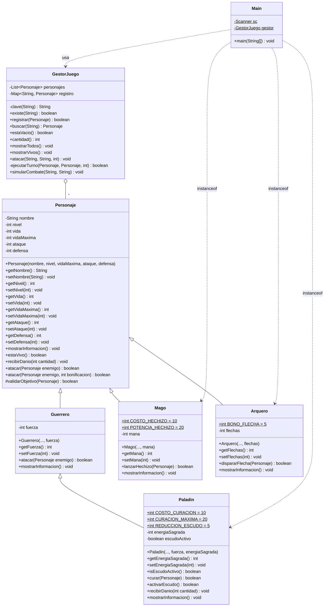

# ⚔️ ESFOT RPG: La Batalla de los Reinos

Prototipo de juego de rol (RPG) por consola desarrollado en **Java** para la tarea integradora de **Programación Orientada a Objetos** (ESFOT).

Permite registrar personajes de cuatro tipos (Guerrero, Mago, Arquero y Paladín), mostrarlos, buscarlos por nombre, usar habilidades especiales y enfrentarlos en combates por turnos.

**Autor:** Andy Martinez · **Asignatura:** Programación Orientada a Objetos · **Repositorio:** https:https://github.com/andyomar2312-sudo/Proyecto-ESFOT---RPG.git

---

## 🎯 Descripción

El proyecto aplica herencia (simple, jerárquica y multinivel), encapsulamiento, constructores, `super`, sobrescritura, sobrecarga, polimorfismo, `instanceof` con casting seguro y colecciones (`ArrayList` y `HashMap`). No usa interfaces, clases abstractas ni patrones de diseño.

## 🗂️ Estructura del proyecto

```
ESFOT-RPG/
├── src/
│   ├── personajes/
│   │   ├── Personaje.java
│   │   ├── Guerrero.java
│   │   ├── Mago.java
│   │   ├── Arquero.java
│   │   └── Paladin.java
│   ├── juego/
│   │   └── GestorJuego.java
│   ├── Main.java        (menú e interacción por consola)
│   
├── docs/
│   ├── resultado_pruebas.txt
│   ├── entrada_demo.txt
│   └── ejemplo_ejecucion.txt
├── capturas/
│   ├── 01_creacion.png
│   ├── 02_busqueda.png
│   ├── 03_habilidades.png
│   └── 04_combate.png
└── README.md
```

`Main` controla la interacción por consola (menú, lectura de datos y despacho de habilidades con `instanceof`). `GestorJuego` administra las colecciones, la búsqueda, los ataques y los combates.

## ▶️ Instrucciones de ejecución

Requisito: **JDK 11 o superior**.

```bash
# 1. Clonar el repositorio
git clone https://github.com/TU_USUARIO/ESFOT-RPG.git
cd ESFOT-RPG

# 2. Compilar (desde la carpeta raíz)
javac -encoding UTF-8 -d out -sourcepath src src/Main.java src/Pruebas.java

# 3. Ejecutar el juego
java -cp out Main

# 4. Ejecutar las pruebas mínimas automáticas
java -cp out Pruebas
```

Si en Windows los acentos se ven mal, ejecuta antes `chcp 65001` o agrega `-Dfile.encoding=UTF-8 -Dstdout.encoding=UTF-8` al comando `java`.

Para repetir la demostración sin escribir datos a mano:

```bash
java -cp out Main < docs/entrada_demo.txt
```

**En IntelliJ IDEA:** abre la carpeta del proyecto, marca `src` como *Sources Root* (clic derecho → *Mark Directory as → Sources Root*) y ejecuta `Main`.

## 🎮 Reglas del juego

| Clase | Atributo propio | Comportamiento |
|---|---|---|
| `Personaje` | nombre, nivel, vida, vidaMaxima, ataque, defensa | `atacar`, `atacar` con bonificación, `recibirDanio`, `estaVivo`, `mostrarInformacion` |
| `Guerrero` | `fuerza` | Sobrescribe `atacar(Personaje)`: potencia = ataque + fuerza |
| `Mago` | `mana` | `lanzarHechizo`: consume 10 de maná, potencia 20 |
| `Arquero` | `flechas` | `dispararFlecha`: consume 1 flecha, potencia = ataque + 5 |
| `Paladin` | `energiaSagrada` | `curar`: consume 10 de energía, recupera hasta 20 de vida. `activarEscudo`: reduce en 5 el daño del siguiente ataque |

**Cálculo del daño.** La defensa se descuenta **una sola vez**, dentro de `Personaje.recibirDanio(int cantidad)`:

```java
int danioReal = Math.max(1, cantidad - defensa);
vida = Math.max(0, vida - danioReal);
```

Los métodos de ataque y las habilidades solo envían la *potencia* (`cantidad`). El escudo del Paladín reduce esa potencia en 5 (mínimo 0), se desactiva y luego llama a `super.recibirDanio(...)`.

**Decisiones de diseño**

- Los nombres no distinguen mayúsculas: "Thor" y "thor" cuentan como duplicados (la clave del `HashMap` es el nombre en minúsculas).
- Un personaje no puede actuar contra sí mismo ni contra un derrotado, y un derrotado no puede actuar.
- Los recursos (maná, flechas, energía) solo se consumen si la acción realmente se ejecuta. Curar a alguien con la vida completa tampoco consume energía.
- En el combate por turnos cada personaje usa su ataque normal (`atacar(Personaje)`), de modo que se ejecuta la versión de su clase real (el Guerrero suma fuerza).
- Los datos inválidos al crear un personaje lanzan `IllegalArgumentException`, que `Main` captura para no terminar el programa. Las entradas no numéricas se vuelven a pedir.

## 🧬 Explicación de la herencia

| Tipo | Dónde se aplica |
|---|---|
| **Simple** | `Guerrero`, `Mago` y `Arquero` extienden `Personaje` (una sola clase padre directa). |
| **Jerárquica** | Una misma superclase, `Personaje`, tiene tres subclases al mismo nivel: `Guerrero`, `Mago` y `Arquero`. |
| **Multinivel** | `Personaje → Guerrero → Paladin`. `Paladin` hereda la fuerza y el ataque sobrescrito de `Guerrero` y, a través de él, todo lo de `Personaje`. |

## 📐 Diagrama UML de clases



## 🧪 Pruebas mínimas

`Pruebas.java` ejecuta de forma automática las 10 pruebas mínimas del enunciado (49 verificaciones). Resultado completo en [`docs/resultado_pruebas.txt`](docs/resultado_pruebas.txt):

```
RESULTADO: 49 pruebas correctas, 0 fallidas.
```

Una sesión completa del menú (creación, duplicado, dato inválido, búsqueda, ataques, habilidades, combate y combate rechazado) está en [`docs/ejemplo_ejecucion.txt`](docs/ejemplo_ejecucion.txt).

## 📸 Capturas de pantalla

**1. Creación de los cuatro tipos de personaje y listado (opciones 1 a 5)**


**2. Búsqueda por nombre, incluyendo uno inexistente (opción 6)**


**3. Habilidades especiales: hechizo, flecha, curación y escudo (opción 8)**


**4. Combate completo con anuncio del ganador (opción 9)**


## ❓ Preguntas de análisis

**1. ¿Dónde se aplica herencia simple en el proyecto?**
En `Guerrero extends Personaje` (y también `Mago extends Personaje` y `Arquero extends Personaje`): cada una de estas clases tiene exactamente una clase padre directa y reutiliza sus atributos y métodos.

**2. ¿Por qué `Personaje → Guerrero → Paladin` representa herencia multinivel?**
Porque hay una cadena de tres niveles: `Paladin` hereda de `Guerrero`, y `Guerrero` a su vez hereda de `Personaje`. Así `Paladin` recibe lo de `Guerrero` (la fuerza y el ataque sobrescrito) y, a través de él, lo de `Personaje` (nombre, vida, defensa, `recibirDanio`, etc.).

**3. ¿Qué relación ejemplifica herencia jerárquica?**
`Guerrero`, `Mago` y `Arquero` heredan todos de la misma clase padre `Personaje`. Una sola superclase tiene varias subclases al mismo nivel.

**4. ¿Cuál es la diferencia entre sobrescritura y sobrecarga de `atacar()`?**
La *sobrescritura* ocurre cuando una subclase redefine un método con la misma firma que el del padre: `Guerrero.atacar(Personaje)` reemplaza la versión de `Personaje` para sumar la fuerza, y se decide en tiempo de ejecución según el objeto real. La *sobrecarga* son varios métodos con el mismo nombre pero distintos parámetros dentro de una clase: `atacar(Personaje)` y `atacar(Personaje, int bonificacion)` en `Personaje`, y el compilador elige cuál llamar según los argumentos.

**5. ¿Qué aporta `super` en constructores y métodos?**
En los constructores, `super(...)` invoca el constructor del padre para inicializar y validar los atributos heredados (por ejemplo, `Mago` llama a `super(nombre, nivel, ...)` y no repite esa lógica). En los métodos, `super.metodo()` ejecuta la versión del padre y permite ampliarla sin duplicarla: `mostrarInformacion()` de los hijos imprime primero lo general con `super.mostrarInformacion()` y luego agrega lo propio; `Paladin.recibirDanio` delega en `super.recibirDanio` para que la defensa se descuente una sola vez.

**6. ¿Por qué `List<Personaje>` admite guerreros, magos, arqueros y paladines?**
Porque todos son subclases de `Personaje`, es decir, "es un" `Personaje`. Una referencia del tipo padre puede apuntar a objetos de cualquier subclase (polimorfismo), así que una sola lista guarda los cuatro tipos.

**7. ¿Qué versión de `mostrarInformacion()` se ejecuta al recorrer la lista y por qué?**
Se ejecuta la de la clase real del objeto, no la del tipo de la variable. Aunque la variable sea de tipo `Personaje`, si el objeto es un `Mago` se ejecuta `Mago.mostrarInformacion()`. Esto se llama enlace dinámico: la JVM elige el método en tiempo de ejecución según el objeto real.

**8. ¿Cuándo se necesita `instanceof` antes de hacer casting?**
Cuando solo se tiene una referencia de tipo `Personaje` y se quiere usar un método que existe solo en una subclase (`lanzarHechizo`, `dispararFlecha`, `curar`). `instanceof` confirma que el objeto real es de ese tipo; sin la comprobación, un casting incorrecto lanzaría `ClassCastException` (por ejemplo, convertir un `Arquero` a `Mago`).

**9. ¿Qué ventaja aporta `HashMap` para localizar un personaje por nombre?**
La búsqueda por clave es prácticamente instantánea (tiempo constante en promedio), sin recorrer todos los personajes como haría una búsqueda en lista. Además `containsKey()` permite detectar nombres duplicados de forma inmediata antes de registrar.

**10. ¿Cómo se protege la consistencia de los atributos mediante encapsulamiento?**
Todos los atributos son `private`, así que ninguna clase externa puede asignarles valores inválidos directamente. Solo se modifican mediante setters y métodos como `recibirDanio`, que validan las reglas (nombre no vacío, nivel y vida máxima positivos, ataque y defensa no negativos, vida entre 0 y `vidaMaxima`). El constructor también usa esos setters, de modo que un objeto nunca nace en un estado inválido.
